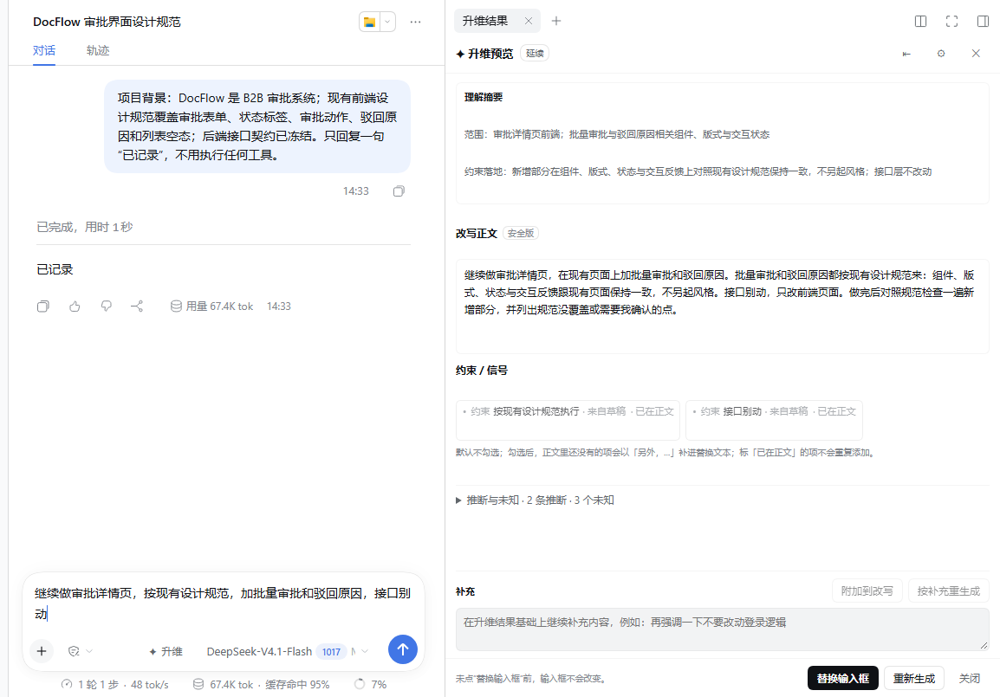

# dsh-input-uplift

A **pre-send "input uplift" plugin** for the [DeepSeek Harness](https://github.com/deepseek-ai) Web / Desktop GUI.

You type a rough request; the plugin asks the session model for a structured, send-ready version of that request, plus an alignment check against recent conversation. It **never touches the composer until you click Replace** and never intercepts sending.



_Example: a DocFlow approval-detail request after uplift, docked as a real DSH right-sidebar tab. The result panel shows the extracted scope, the rewritten message, and constraints already covered by the rewrite. The personal session sidebar is cropped out of this screenshot._

> Status: M1 prototype (v0.1.10). It uses DSH client-internal slots and services (`conversation.input.*`, `inputActions`, `sidebarRightTabs`), so it is best installed as a local link plugin. Not published to npm.

## Features

- **Trigger**: `✦ 升维` in the composer tool row, or `Mod+Alt+U`.
- **Floating card / real right-sidebar tab**: the result can sit above the composer, or in DSH's right sidebar as a proper docked tab (the conversation makes room; it does not cover it).
- **Rewrite quality rules**: understands project/domain, scope, intent and constraints before writing; keeps all concrete details; one constraint mentioned once; no template labels such as “本次任务：/需要保持的约束：”.
- **Alignment check**: flags conflicts, duplicates, changed confirmations and stale assumptions with verbatim context quotes. The latest user message is authoritative; adopting findings appends correction sentences to the rewrite (single or multi-select).
- **Settings**: detail level (concise / standard / detailed), balanced mode, explicit provider/model override, custom auto-uplift delay (0–120 s), display mode.
- **Auto-uplift**: trigger automatically after N idle seconds; suppressed when the draft came from the plugin's own replacement (no nested generation).
- **Supplement box**: append extra requirements to the rewrite, or regenerate with them integrated.
- **Replace-only-when-you-click**: `insertText` replacement with an independent undo; `@` references trigger a confirmation because `setDraft` drops them.
- **Optional chips**: constraints/signals already expressed in the rewrite are marked *already in rewrite* and disabled; checking a genuinely missing item appends one natural “另外，…” sentence.
- `mock: true` config for UI trials without a model.

## Requirements

- Node.js `>=22.19.0` (build/test).
- DeepSeek Harness Desktop / Web runtime `0.2.1-rc.x` with a configured model.
- No npm runtime dependencies; host build keeps `@deepseek-ai/dsh-llm` external and resolves it from DSH at runtime.

## Build

```bash
git clone https://github.com/omokom/dsh-input-uplift.git
cd dsh-input-uplift
npm install
npm run typecheck
npm run build
npm test
node scripts/check-bundle.mjs
```

`npm run build` produces:

- `lib/index.js` — ESM host plugin (session context + LLM call + HTTP routes);
- `lib/client.js` — CJS browser bundle wrapped in `window.__ModuleLoader__.load({ id: "@local/dsh-input-uplift", factory })`.

`lib/` is committed so the plugin can be linked without rebuilding. After changing `src/`, run `npm run build` again.

## Install into DSH Desktop

1. Build the package (or use the committed `lib/`).
2. DSH Desktop → **Settings → Plugins** → add a local/development plugin with:
   `link:<absolute-path-to-this-repo>`
3. Restart the desktop app once when the package/profile dependency is added.
4. Open a live conversation; `✦ 升维` appears in the composer tool row.

Notes:

- Host changes (`lib/index.js`) need a desktop restart. Client changes (`lib/client.js`) may hot-replace only while a dev watcher is running; restarting is the reliable path.
- The package name is kept as `@local/dsh-input-uplift` on purpose so the existing local profile link and `cordis.patch.yml` stay stable. Forking under another name requires updating `package.json#name` and `cordis.patch.yml`.
- Configuration is passed through the loader row config; there is no settings-form schema yet:

```yaml
- id: input-uplift
  name: '@local/dsh-input-uplift'
  config:
    mock: false
```

### Configuration

| Field | Default | Description |
|---|---|---|
| `mock` | `false` | Return a deterministic local mock result; no model call. |
| `provider` / `model` | empty | Explicit route override (both required together). Selection order: explicit override → session request header → global agent default → this config. |
| `temperature` | `0.3` | 0–2. |
| `maxTokens` | `4096` | 512–12000. One retry with a larger budget follows an empty/unparseable reply. |
| `timeoutMs` | `20000` | 1000–120000. |
| `contextTurns` | `12` | Most recent user/assistant text messages considered (1–24). |
| `maxContextBytes` | `12000` | Soft context budget; latest assistant conclusions are retained first. |
| `maxDraftBytes` | `24000` | Draft size limit (request body itself is capped at 64 KiB). |
| `includeLastAssistant` | `true` | Pin the latest 1–2 assistant conclusions for the alignment check. |

HTTP routes (same-origin, authenticated by the DSH connection):

- `POST /api/input-uplift/reorganize` — `{ sessionId, draft, options?, extra? }` → structured `UpliftResult`.
- `GET /api/input-uplift/models` — provider/model catalog for the settings panel.

## Usage

1. Write a draft in a live conversation.
2. Click `✦ 升维` (or press `Mod+Alt+U`). The composer stays editable; sending the draft closes the card.
3. Review the card:
   - **Understanding** — purpose, scope, how constraints apply;
   - **Alignment check** — adopt/ignore findings (multi-select + adopt all);
   - **Rewrite** — the candidate send-ready message;
   - **Constraints / signals** — items already present are disabled and marked; missing ones are opt-in;
   - **Supplement** — append to the rewrite, or regenerate with it.
4. Click **Replace composer** (or **Replace** in the sidebar tab) only when you want to write it back. **Restore original** appears after replacement until the draft changes.
5. `Esc` closes the card; settings and display mode are stored in `localStorage`.

The sidebar tab is opened from **⚙ Settings → Display → Side drawer**, or the card header `⇥` button; `⇤` closes the tab and returns to the floating card.

## How it works

Host half (`src/index.ts`):

- validates the request and active session;
- derives recent text from `session.deriveMessages()`;
- builds the system/user prompts (`src/host/prompt.ts`), calls `ctx.llm.prepareCall(...)` → `prepared.stream(...)` → `BlockAssembler` (or `ctx.llm.stream` fallback) at the model's lowest reasoning effort;
- parses/normalizes the single JSON object (`src/host/contract.ts`) and returns it. Diagnostics with truncated output snippets are appended to `$DSH_HOME/cache/dsh-input-uplift/diag.ndjson` when a reply is unusable.

Client half:

- `src/client/index.tsx` registers the composer trigger, floating card, shortcut, locale dictionaries and the right-sidebar tab type;
- `UpliftPanel.tsx` renders the card/tab, settings, alignment adoption, chips and supplement controls;
- `store.ts` keeps per-session card state with request fencing; `compose.ts` builds the replacement text (semantic dedupe, no template labels);
- `sidebar.ts` bridges to `ctx.sidebarRight.openTab/close`.

```
src/
├── index.ts              # host entry: routes, context, LLM call
├── host/{prompt,contract,compose}.ts
├── client/index.tsx      # slots, shortcut, locale, sidebar tab registration
├── client/UpliftPanel.tsx
├── client/TriggerButton.tsx
├── client/store.ts
├── client/sidebar.ts
├── client/i18n.ts        # zh / en
└── client/*.tsx
test/                     # prompt, contract and compose unit tests
scripts/check-bundle.mjs  # purity / envelope bundle gate
docs/screenshots/readme/  # sanitized README hero image (personal UI chrome cropped)
```

## Privacy / model boundary

- Drafts are not written to session logs by this plugin.
- Uplift is an auxiliary model call whose input is the unsent draft plus the recent text context (system/tool/attachment content is excluded).
- The draft is only modified when you explicitly click Replace; the plugin never sends messages on your behalf.

## Known limitations

- M1 prototype; DSH client slots and services are runtime-internal APIs and may change between DSH releases.
- Alignment “adopt” appends the model-provided correction sentence; it does not perform a full diff/merge or expose the dangerous `rewrite_override` variant.
- No diff highlighting, close-to-editor focus restore, `/`/`@` menu mutual exclusion, config form schema, result cache, or global concurrency limit.
- Context is plain text only; a very long pinned assistant message can exceed the soft context budget.
- Model cost/latency apply; the plugin makes one helper call per generate/regenerate (plus one retry on empty/unparseable output).
- Screenshots are sandbox evidence, not a pixel-perfect guarantee of every desktop theme.

## License

MIT — see [LICENSE](LICENSE).
